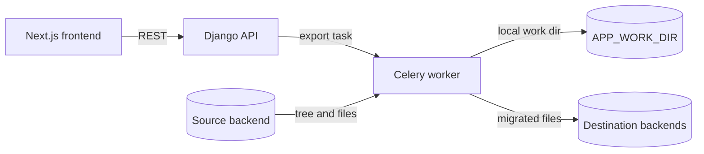

# Architecture

This document explains how a migration flows through the code. Read it before
touching `src/backend/core/`. For the local setup, see the
[README](../README.md), or [this guide](./local-setup-with-drive.md) to run it
with a local Drive.

## Overview

The migrator reads a workspace from **one source** platform and writes it to
**one or more destinations**. The API takes the destinations of each workspace;
the frontend sends a single one, `archive` or `drive`, for the whole selection
(`core/migrationTarget.ts`).
Production runs the Resana source with the Drive destination.



| Component | Where | Role |
|---|---|---|
| Frontend | `src/frontend/apps/main/` | Lists the workspaces, starts migrations, shows their status |
| API | `src/backend/core/api/`, `core/urls.py` | DRF views, prefix `api/v1.0/` |
| Worker | `src/backend/core/processing/tasks.py` | The `export` Celery task, one per workspace |
| Source backends | `src/backend/core/sources/` | Read the workspace tree and download its files |
| Destination backends | `src/backend/core/destinations/` | Receive the files |
| Admin | `src/backend/core/admin.py` | Follow runs, integrity reports, feature flags |

The frontend calls the API through a hand-written client
(`src/frontend/apps/main/src/api/fetchApi.ts`). `make tsclient` can generate a
client from the OpenAPI schema ([tsclient.md](./tsclient.md)), but the frontend
does not use it.

## Pluggable backends

Sources and destinations are loaded from settings, so a deployment picks its
platforms without code change.

### Source: `SOURCE_BACKEND`

A single source per deployment, contract in `core/backends/source.py`
(`AbstractSourceBackend`).

| Backend | `source_type` | Notes |
|---|---|---|
| `core.sources.osmose.backend.OsmoseSourceBackend` | `osmose` | Default value of the setting |
| `core.sources.resana.backend.ResanaSourceBackend` | `resana` | Reads the Interstis GED API with the user's Resana token |
| `core.sources.filesystem.FileSystemSourceBackend` | `filesystem` | Local directory tree, used in development |

`source_type` is stored on each `Workspace`: never rename it once workspaces
exist.

A source implements:

- `get_workspaces(user)`: called by `GET synchronize/` to fill the DB with the
  workspaces the user can see. Workspaces gone from the source are kept.
- `get_workspace_structure(workspace)`: the full tree as `SourceFolder` /
  `SourceFile` dataclasses. The root folder is virtual.
- `download_file(file, path)`: writes one file to disk, retries included.
- Optional hooks, called by the task in this order:
  `begin_export` (before reading the tree), `prepare_export` (fills
  `workspace.members`), `finalize_export` (always, in a `finally`, must not
  raise). Resana uses `begin_export` / `finalize_export` to lock the workspace
  and grant the migration account access to its top-level folders, then restore
  what the run changed
  (`core/sources/resana/resana_lock_client.py`, issue #215).

### Destinations: `DESTINATION_BACKENDS`

A list of backends, contract in `core/backends/destination.py`
(`AbstractDestinationBackend`), loaded and cached by `DestinationRegistry`.
Each one has a `name` (key in `Workspace.destination_statuses`) and a `label`.
`env.d/development/common.dist` only enables the archive, so add Drive there to
try it locally.

| Backend | `name` | Export |
|---|---|---|
| `core.destinations.archive.backend.ArchiveDestinationBackend` | `archive` | Zips the local folder and uploads the zip to S3 (`processing/folder_helper.py`) |
| `core.destinations.drive.backend.DriveDestinationBackend` | `drive` | Recreates the local tree through the La Suite Drive external API |
| `core.destinations.resana.backend.ResanaDestinationBackend` | `resana` | Uploads the workspace to S3, then starts an async Resana import job |

A destination implements `export(workspace, user, local_folder_path)`, called
once every file is on disk, and sets its status in
`Workspace.destination_statuses`. Async destinations (Resana) leave it
`PENDING`; the `refresh_resana_jobs` management command polls the job and sets
the final status. No API endpoint calls the `poll_completion` hook, despite its
docstring.

Other hooks: `get_account_policy` / `user_account_exists` /
`get_account_creation_url` (does the user need an account on the destination
before migrating), `describe_rejection` (user-facing reason of a rejected
file), `check_integrity` (see [migration-integrity-check.md](./migration-integrity-check.md)).

## Lifecycle of a migration

### 1. Synchronize

`GET api/v1.0/synchronize/` calls `SourceManager.synchronize(user)`: one
`Workspace` row per source workspace, linked to the user (`User.workspaces`).
While `read-only-mode` is active, it answers 200 and synchronizes nothing, see
[feature flags](#feature-flags).

### 2. Start

`POST api/v1.0/workspaces/process` (`core/api/views/workspaces_process.py`)
receives `{"workspaces": {workspace id: [destination names]}}` and:

1. Refuses when the `allow-new-tasks` feature flag is off.
2. Validates before queuing: the user exists on Resana (Resana
   destination), the Drive token can be refreshed (`DRIVE_AUTH_MODE=user_token`),
   the Resana source session is valid, the destination account exists
   (`AccountPolicy.USER_CREATED`).
3. Sets each chosen destination to `PENDING` in
   `workspace.destination_statuses`. The task reads these statuses, so this
   happens before queuing.
4. Queues `export.delay(...)` and creates an `ExtraTaskInfo` linking the
   Celery `TaskResult`, the workspace and the user.

A workspace is refused unless its overall `status` is `NONE`. That status is
computed from every destination (`Workspace.compute_status`), so a workspace
already migrated (`SUCCESS` or `FAILURE`) is refused too. This check runs
workspace by workspace, so a batch can be partly queued before it is refused.
To migrate a workspace again, in the admin:

- A `FAILURE` workspace: the **Retry failed** button relaunches its failed
  destinations. The whole workspace is downloaded again, and Drive creates a
  second root folder next to the partial one.
- Otherwise: set `Status` to `NONE`, and `Destination statuses` and
  `Destination metadata` to `{}`. Saving in the admin does not recompute
  `status`.

The `set_workspaces_status_none` command resets **every** workspace.

### 3. The `export` task

`core/processing/tasks.py`, one task per workspace:

```
begin_export                      source: lock / grant access
get_workspace_structure           source tree
IntegrityTracker(tree)            snapshot before truncation
truncate_folder_files             MIGRATION_FILE_LIMIT_PER_WORKSPACE (0 = no limit)
_export_workspace
  FolderCreator.create_folder     download every file to APP_WORK_DIR/workspace_<id>
  prepare_export                  source: workspace.members
  destination.export              each PENDING destination, in turn
IntegrityTracker.save             report on ExtraTaskInfo
finalize_export                   source: unlock (always)
```

Key points:

- **The whole workspace goes through the local disk**: every file is downloaded
  to `APP_WORK_DIR` before any destination runs. The worker runs with
  `--concurrency=1`, so the disk must hold the largest workspace, and up to
  three times its size for the archive: the folder, the zip and its rewritten
  `.utf8` copy coexist for a moment.
- **Paths** are computed while downloading (`processing/folder_creator.py`):
  names are sanitized and truncated, duplicates get a suffix, and a name
  escaping its folder (e.g. `..`) is refused and recorded as a failed file.
- **Downloads are sequential** in the task. A failed download is recorded in
  `Workspace.download_errors` and never aborts the run, unless every file
  failed.
- **Destinations run one after the other**: in the `DESTINATION_BACKENDS` order. An
  exception in a destination stops the task, so the next ones do not run and
  every destination still `PENDING` ends up `FAILURE`. That includes a Resana
  job already started: `refresh_resana_jobs` then stops following it.
- Files Drive rejected are kept aside and handed back to the user
  (`processing/rejected_files.py`).

### 4. End of the task

Celery signals at the bottom of `tasks.py`:

- `task_success`: PostHog `migration_finished` event, local folder deleted.
- `task_failure`: destinations still `PENDING` set to `FAILURE`, PostHog
  event, local folder deleted, failure mail to the user.

Success mails are sent by the archive and Drive destinations at the end of
`export`, and by Resana once `refresh_resana_jobs` sees its job
finished. Mail templates are
MJML files in `src/mail/`, compiled with `make mails-build`.

## Data model

`core/models.py`:

| Model | Purpose |
|---|---|
| `User` | OIDC user (`sub`). Also holds the encrypted Drive OIDC tokens and Resana tokens / session |
| `Workspace` | A source workspace: `source_id`, `source_type`, `destination_statuses` (`NONE`, `PENDING`, `SUCCESS`, `FAILURE` per destination), `status` (computed from them), `destination_metadata`, `members`, `migration_user`, errors, Resana lock state, integrity tracking override |
| `ExtraTaskInfo` | One per run: links the Celery `TaskResult` to the workspace and user, stores the integrity report |
| `FeatureFlag` | See [feature flags](#feature-flags) |
| `ResanaEmailMapping` | Email domain to Resana organization |

### Feature flags

No migration creates the flags, and a missing row counts as active, except for
`file-integrity-tracking`. On a fresh database, create `read-only-mode` as
inactive in the admin, or nothing synchronizes.

| Flag | If missing | When active |
|---|---|---|
| `allow-new-tasks` | Active | Migrations can be started |
| `read-only-mode` | Active | `synchronize/` does nothing, and the frontend adapts |
| `auto-validate-new-users` | Active | New users are active at once; otherwise they wait on `/account-pending` |
| `file-integrity-tracking` | Inactive | Integrity check for workspaces following the flag |

## Authentication

Several tokens are involved, each with its own flow:

- **Login to the migrator**: OIDC with `mozilla-django-oidc`
  (`core/authentication/`). Keycloak in development, ProConnect in production.
  The OIDC tokens are kept, encrypted (`core/encryption.py`), to call Drive on
  behalf of the user.
- **Drive**, `DRIVE_AUTH_MODE`. With `DRIVE_SHARE_MEMBERS` (default), the
  workspace members also become owners of the root item:
  - `service_account` (default): OAuth2 client credentials
    (`DRIVE_OIDC_TOKEN_ENDPOINT`, `DRIVE_OIDC_CLIENT_ID`,
    `DRIVE_OIDC_CLIENT_SECRET`); the migration user is shared as owner of the
    created items.
  - `user_token`: the user's OIDC token, refreshed with
    `OIDC_OP_TOKEN_ENDPOINT` and the migrator's OIDC client; Drive makes the
    token holder the owner.
    `DRIVE_ACCOUNT_POLICY` says whether the user must have logged in to Drive
    before.
- **Resana as source**: a separate PKCE login against the Resana Keycloak
  (`resana-migrator` client) through the Interstis bridge, MFA included
  (`core/api/views/resana_auth.py`, `core/sources/resana/migrator_auth.py`,
  `token_manager.py`). Its endpoints are only mounted when
  `EXTRA_API_URL_MODULES` contains `core.sources.resana.urls`.
- **Resana as destination**: technical account (`RESANA_AUTH_USER` /
  `RESANA_AUTH_PASSWORD`).

## Cross-cutting concerns

- **HTTP retries**: every platform API call goes through `RetryingSession`
  (`core/retrying_session.py`), which retries transient errors with
  exponential backoff (`*_RETRY_*` settings per platform). In a web request,
  `limited_retries(...)` caps the attempts so the request answers in time. The
  login flows (`core/sources/resana/migrator_auth.py`,
  `core/authentication/backends.py`) call `requests` directly.
- **Storage**: S3 compatible (MinIO in development). Used by the archive
  destination, the Resana import and the rejected files archive.
- **Integrity check**: opt-in per-file report, see
  [migration-integrity-check.md](./migration-integrity-check.md).
- **Observability**: Sentry (`SENTRY_DSN`), PostHog events
  such as `workspaces_synchronized`, `migration_started` and
  `migration_finished` (`core/analytics.py`), Celery
  Flower, and the Django admin for runs and their reports.
- **Operations commands** (`core/management/commands/`):
  `refresh_resana_jobs` (a Helm CronJob every minute, by hand in local),
  `set_workspaces_status_none` (resets every workspace),
  `celery_liveness` / `celery_readiness` (Kubernetes probes).

## Adding a platform

- **New source**: subclass `AbstractSourceBackend` with `source_type` and
  `label`, implement the three abstract methods, point `SOURCE_BACKEND` to it.
  Use the hooks if the platform needs a lock or extra rights during the run.
- **New destination**: subclass `AbstractDestinationBackend` with `name` and
  `label`, implement `export`, which must set the destination status and send
  the end-of-migration mail, and add it to `DESTINATION_BACKENDS`. Implement
  `check_integrity` to make it part of the integrity report. To offer it in the
  frontend, update `core/migrationTarget.ts`, which hardcodes the destinations.
- Wrap its HTTP calls in a `RetryingSession`: it needs the
  `<PREFIX>_RETRY_MAX_ATTEMPTS`, `_WAIT_MULTIPLIER` and `_WAIT_MIN` settings,
  and only replays a POST with `retry=True`.
