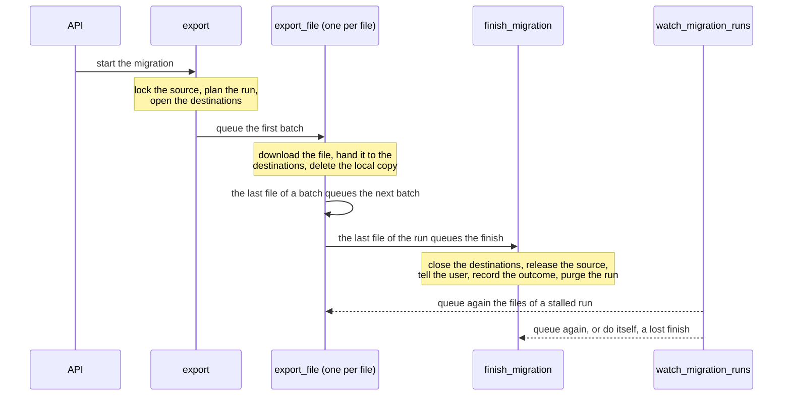

# Migration pipeline

A migration runs as several Celery tasks, so that the worker disk only holds
the file being transferred, and so that migrations started together share the
workers.

- `export` plans the run: it locks the source workspace, reads its tree,
  stores one row per file (`MigrationRun`, `MigrationFile`), opens the
  destinations, then queues the first batch of files.
- `export_file`, one per file: downloads the file, hands it to the
  destinations, then deletes the local copy.
- `finish_migration`, once every file is done: closes the destinations,
  releases the source workspace, tells the user and records the outcome, then
  purges the rows of the run. Purged last, a run whose finish died midway is
  still there for the watchdog; one recorded already is only purged.

Only `export` gets a row in the Django admin (`Task results`). It stays
`STARTED` while the run goes on, until `finish_migration` sets its status,
date and error.



How a source and a destination take part in each step is described in
[backends.md](backends.md).

## Working rows

A run lives in two tables, purged once its outcome is recorded:

- `MigrationRun`, one per migration, found by the `task_id` of its `export`.
  It holds the planned folders (`dirs`), the counters of its batches
  (`cursor`, `in_flight`, `remaining_files`), what stops it
  (`source_token_expired`, `stalled`), what keeps its finish from running
  twice (`finish_published`, `finish_started`), the `redispatches` of the
  watchdog, and the state its tasks share:
  - `destinations_state`: what each destination keeps for its next calls,
    e.g. the ids of the Drive folders;
  - `exports_state`: the error, files failed in a row and closing of each
    destination, kept by `FileExports`;
  - `integrity_state`: what the integrity report compares, see
    [migration-integrity-check.md](migration-integrity-check.md).
- `MigrationFile`, one per planned file, in download order (`position`). It
  holds the source file (`source`), its `path` in the workspace, its download
  `status` (`pending`, `downloaded`, `download_failed`, `not_written`), its
  `size` and the `expected_size` the source announced, an `error`, what each
  destination did with it (`results`), the S3 copy kept for the user when a
  destination did not take it (`kept_key`), and `finished_at` once its task is
  done.

A file refused while planning, e.g. a path escaping the workspace, gets a
`download_failed` row from the start and counts as done.

Before the purge, the finish saves what outlives the run on its task: the
integrity report and the stats of the files for the analytics. The S3 copies
no zip of refused files lists are deleted.

While a migration runs, the Django admin shows its progress, `done/total`
files, in the `Progress` column of its task, in the list of tasks and on
the page of its workspace; `-` before the run is planned and once it is
purged.

## Batches

The file tasks of a run are queued one batch at a time: the last file of a
batch queues the next batch. A migration started after another one then gets
the workers between two batches, instead of waiting for the whole run.

| Variable | Default | Meaning |
| --- | --- | --- |
| `MIGRATION_BATCH_MAX_FILES` | `100` | Files in a batch at most. |
| `MIGRATION_BATCH_MAX_BYTES` | `1073741824` (1 GiB) | Bytes in a batch at most, from the sizes the source announces (Resana rounds them to 0.01 MiB). |

`0` means no limit; both at `0` queue the whole run at once. A batch always
holds at least one file, even one bigger than `MIGRATION_BATCH_MAX_BYTES`.

## Redis visibility timeout

With the Redis broker, a message a worker has taken but not acknowledged yet
goes back to the queue after the `visibility_timeout`, 1 hour for Redis. A
worker reserves its next message while it runs a task: when that task lasts
longer than the timeout, the reserved message is delivered again, and the same
file is exported twice. A second copy of an export, or of a file task whose
file is done, is skipped; a file task still running is not, and its file is
sent twice at once.

The timeout defaults to 12 hours here. Keep it above the longest task, i.e.
the transfer of the biggest file or the planning of the biggest workspace;
setting the variable replaces the whole dictionary:

```
DJANGO_CELERY_BROKER_TRANSPORT_OPTIONS={"visibility_timeout": 43200}
```

The other side: a message reserved by a worker killed outright (out of
memory, node lost) waits for the whole timeout before another worker takes
it. A file task is queued again sooner by the watchdog, but a migration not
started yet starts that much later. A worker stopped gracefully hands its
reserved messages back at once.

## Failures

One file, or one destination, failing never stops the rest of the run:

| What fails | What happens |
| --- | --- |
| A file fails to download | The file is `download_failed` and the run goes on. The files that failed are attached to the mail as a CSV. When every file failed, the run fails. |
| A destination refuses a file, or loses it | Its result is `rejected` or `failed`. The file is kept on S3, and the destination hands it back to the user as a zip linked from its mail. |
| A destination raises, or loses `MIGRATION_DESTINATION_MAX_CONSECUTIVE_FAILURES` files in a row | The destination is disabled: it gets no more files, it is aborted at the finish, and the migration fails once the other destinations are closed. Those keep their outcome, e.g. a Resana import running goes on. |
| No destination opens | The run fails at its start, before queuing any file. |
| Every destination gets disabled during the run | The files left are not downloaded, and the run fails at its finish. |
| An unexpected error in a file task | The error is kept on the file, and the run goes on. |
| A database error in a file task | The task is retried after 15, 30, 60, 120, then 240 seconds. |
| The source token expires | See [Expired source token](#expired-source-token). |
| A worker dies | See [Watchdog](#watchdog). |

When the migration fails, the destinations still pending are marked failed,
the local folder is deleted and the user gets a failure mail.

| Variable | Default | Meaning |
| --- | --- | --- |
| `MIGRATION_DESTINATION_MAX_CONSECUTIVE_FAILURES` | `10` | Files failing in a row (rejections aside) after which a destination is deemed unusable. |

## Expired source token

When the source token expires during a run, the run stops: the files already
queued are skipped, no further batch is queued, and the migration fails asking
the user to log in to the source again.

## Watchdog

A worker killed in the middle of a task (out of memory, node lost, redeploy)
leaves its run waiting for a file, or a finish, that never ends, with the
source workspace locked. The `watch_migration_runs` command, run every 10
minutes by the `watch-migration-runs-job` CronJob of the Helm chart, handles
every run without news for `MIGRATION_RUN_STALL_SECONDS`:

- a run whose files are all done gets its finish queued, when it was lost;
- its files queued and never finished, or its next batch when it was never
  queued, are queued again, up to `MIGRATION_RUN_MAX_REDISPATCHES` times
  without progress: each file done gives the run its redispatches back;
- then, or when its start was lost, the run is marked stalled and its finish
  queued: its destinations are aborted, its source workspace released, and
  the migration fails telling the user;
- a finish is lost when it was queued and never started, or when it started
  and went silent for the stall time once per redispatch, plus once. With
  every file done, the migration succeeded: a lost finish is queued again,
  up to twice `MIGRATION_RUN_MAX_REDISPATCHES` times, to close the
  destinations left in a worker. Otherwise, only a finish never started is
  queued again, up to `MIGRATION_RUN_MAX_REDISPATCHES` times: these count
  with the run's own, so the finish of a run stalled once its redispatches
  are spent is not. Past that, or
  for one that went silent, the finish is done by the command itself, as
  failed: the destinations left are aborted. Either way, a destination a
  former finish closed, such as a Resana import running, is left as it is,
  and one whose closing was cut short is aborted rather than closed twice.

| Variable | Default | Meaning |
| --- | --- | --- |
| `MIGRATION_RUN_STALL_SECONDS` | `10800` (3 hours) | Time without news after which a run is stalled. |
| `MIGRATION_RUN_MAX_REDISPATCHES` | `2` | Times a stalled run is queued again without progress before it fails; twice that for the finish of a run whose files are all done. |

A run shows alive each time one of its files, or its finish, starts, and
before each of its destinations opens or closes. Waiting in the queue behind
the batches of other runs is no news, so keep `MIGRATION_RUN_STALL_SECONDS`
above that wait plus the transfer of the biggest file. Otherwise, files still
waiting are queued again for nothing, and a file still transferring is sent
twice at once.

The watchdog only sees runs: a worker killed while `export` reads the tree
of the workspace, before its run is stored, leaves the source workspace
locked with no run to handle.

## Archive download

The archive destination stores each file on S3 on its own, with a manifest
listing them and the folders. The zip is never stored: it is streamed from
S3 when the user downloads it, its files stored as they are (not
compressed), so that its size is known before it starts.

A download holds an API thread for its whole length: at most
`ARCHIVE_MAX_CONCURRENT_DOWNLOADS` run at once, counted in the cache across
the API processes. Beyond, the API answers `429` and the user retries later,
so that it keeps threads to answer the other requests.

| Variable | Default | Meaning |
| --- | --- | --- |
| `ARCHIVE_MAX_CONCURRENT_DOWNLOADS` | `12` | Archive downloads streamed at once. |
